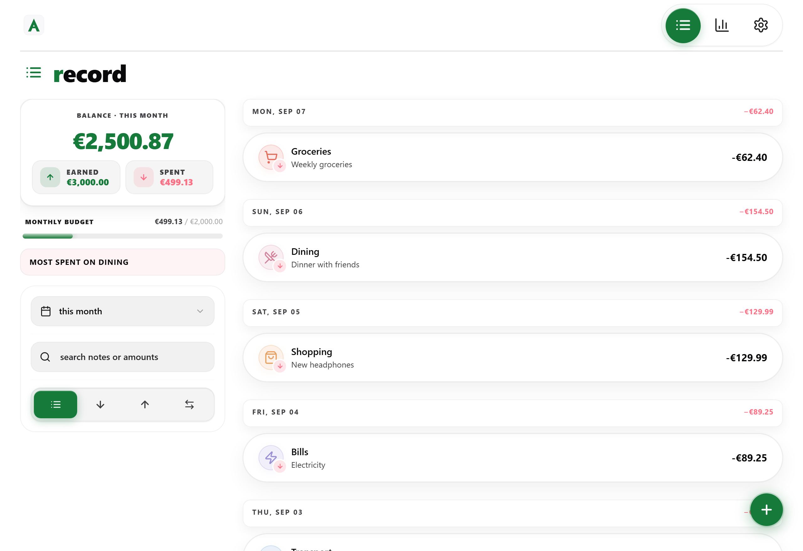
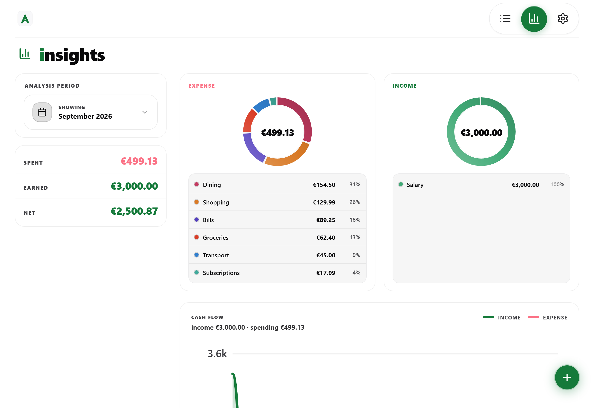
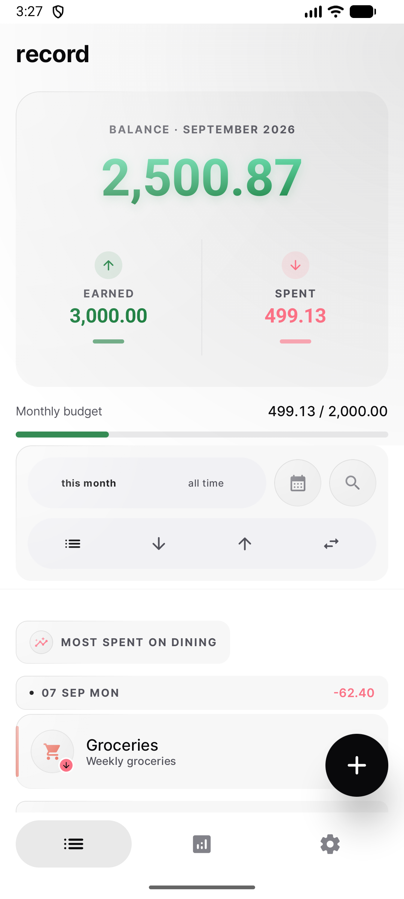
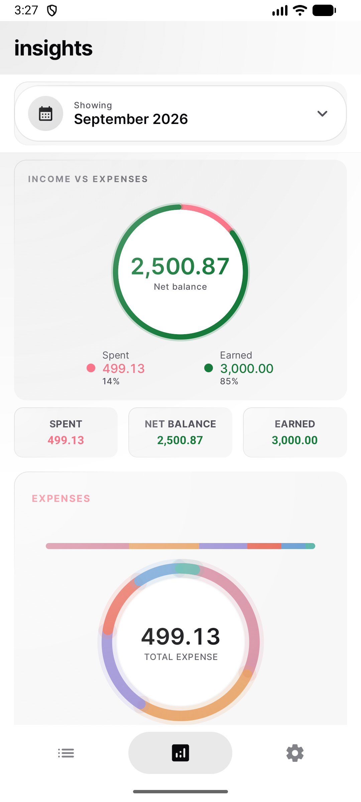

# Ausgegeben — Personal Finance Tracker

**Ausgegeben** is an offline-capable, cross-platform personal finance tracker I built for Android and the web.

I built Ausgegeben because I wanted a fast, private, and distraction-free tool to track my day-to-day spending, monthly budgets, and recurring bills across my phone and laptop without relying on third-party banking aggregators, subscription services, or intrusive ads.

[Launch Web App](https://aus01.web.app) · [Download Android APK](https://github.com/shareef01/ausgegeben/releases/latest)

---

## Screenshots

### Web (PWA)

<p>
  <picture>
    <source media="(prefers-color-scheme: dark)" srcset="docs/screenshots/web/web-record-dark.png">
    <source media="(prefers-color-scheme: light)" srcset="docs/screenshots/web/web-record-light.png">
    
  </picture>
  <picture>
    <source media="(prefers-color-scheme: dark)" srcset="docs/screenshots/web/web-insights-dark.png">
    <source media="(prefers-color-scheme: light)" srcset="docs/screenshots/web/web-insights-light.png">
    
  </picture>
</p>

### Android

<p>
  <picture>
    <source media="(prefers-color-scheme: dark)" srcset="docs/screenshots/android/record-dark.png">
    <source media="(prefers-color-scheme: light)" srcset="docs/screenshots/android/record-light.png">
    
  </picture>
  <picture>
    <source media="(prefers-color-scheme: dark)" srcset="docs/screenshots/android/insights-dark.png">
    <source media="(prefers-color-scheme: light)" srcset="docs/screenshots/android/insights-light.png">
    
  </picture>
</p>

*Screenshots are generated automatically from clean demo accounts using local Firebase emulators.*

---

## Features

- **Fast Transaction Logging:** Log expenses, income, and account transfers in seconds with custom categories and notes.
- **Category Budgets & Trends:** Set monthly spending targets per category, track spending velocity against month progress, and view cash flow breakdowns.
- **Recurring Transactions:** Automate periodic expenses and bills with deterministic scheduling that prevents duplicate charges even after network dropouts.
- **Offline-First Resilience:** Transactions save immediately to local device storage and sync to Cloud Firestore once an internet connection is restored.
- **Search & Filtering:** Instant client-side search by note, amount, date range, transaction type, or category.
- **Safe Backup & Restore:** Export and import versioned, integrity-checked JSON backups with automatic safety snapshots before destructive replace operations.
- **Privacy & Security:** Zero third-party ad networks, no analytics trackers, and strict Firebase security rules that enforce complete account isolation.
- **Localization & Themes:** Supports English and German, multiple display currencies (EUR, USD, GBP, CHF), and light, dark, and OLED themes.
- **Android Reminders:** Configurable daily notification reminders powered by Android WorkManager.

---

## Tech Stack

| Layer | Technologies | Highlights |
|---|---|---|
| **Android Client** | Kotlin, Jetpack Compose, Material 3, Hilt, WorkManager, DataStore | Modern declarative UI, single-activity architecture, offline persistence, and signed release builds. |
| **Web Client** | React 19, TypeScript, Vite, Zustand | Mobile-first responsive PWA, custom accessible UI components, and fast cold-start performance. |
| **Backend & Sync** | Firebase Authentication, Cloud Firestore | Serverless Spark architecture; isolated per-user document trees secured by fine-grained Firestore security rules. |
| **Shared Contracts** | Cross-platform JSON test fixtures | Shared mathematical parity suites (`testdata/money-parity.json`) verify identical rounding and validation logic across Kotlin and TypeScript. |
| **CI / CD** | GitHub Actions | Automated linting, unit tests, CSS token validation, Android compilation, and release packaging pinned by commit SHAs. |

---

## How It Works

```text
┌─────────────────────────┐          ┌─────────────────────────┐
│     Android Client      │          │     React Web (PWA)     │
│ (Kotlin, Compose, Hilt) │          │ (TypeScript, Vite, Zsd) │
└────────────┬────────────┘          └────────────┬────────────┘
             │                                    │
             │   Firestore SDK Offline Cache      │
             ▼                                    ▼
┌──────────────────────────────────────────────────────────────┐
│                    Cloud Firestore                           │
│  users/{uid}/expenses                                        │
│  users/{uid}/categories                                      │
│  users/{uid}/recurringTemplates                              │
│  users/{uid}/safetySnapshots                                 │
└──────────────────────────────────────────────────────────────┘
```

1. **User Data Isolation:** Every authenticated user writes exclusively within `users/{uid}/*`. Firestore security rules reject any read or write attempted outside the caller's verified UID.
2. **Local Cache First:** Both clients read and write through the Firestore offline cache. Saving an expense completes immediately in the UI without waiting for network round-trips.
3. **Idempotent Recurring Engine:** Recurring transaction instances are keyed by canonical hash receipts (`uuid_yyyy-mm-dd`). Even if network sync stutters or multiple tabs run simultaneously, an occurrence is materialized at most once.
4. **Disaster Recovery:** A full JSON export includes expenses, categories, recurring templates, and preferences. During a restore, the client creates a reversible pre-restore safety snapshot before applying new records in budgeted batches.

---

## Live Demo & Download

- **Web Application:** [aus01.web.app](https://aus01.web.app) (Installable Progressive Web App)
- **Android Releases:** [GitHub Releases](https://github.com/shareef01/ausgegeben/releases) (Signed, installable APKs)

---

## Running Locally

### Prerequisites

- **Node.js:** 22+
- **JDK:** 21+ (matching modern Android Studio JBR)
- **Android Studio:** Ladybug or newer with Android SDK 37 (for Android development)

### Web App Setup

```bash
cd web
npm install

# Copy example environment configuration
cp .env.example .env.local

# Start the Vite development server
npm run dev
```

Run test suite and quality checks:
```bash
npm test              # Run unit tests (Vitest)
npm run lint          # TypeScript typecheck
npm run lint:css      # Validate CSS class token coverage
npm run build         # Production PWA build
```

### Android Setup

1. Open the project root in **Android Studio**.
2. Create an empty `app/google-services.json` or copy the CI placeholder:
   ```powershell
   Copy-Item app/google-services.ci.json app/google-services.json
   ```
3. Run the debug build and tests via Gradle:
   ```powershell
   .\gradlew.bat assembleProdDebug
   .\gradlew.bat testProdDebugUnitTest
   ```

*(See [ANDROID_STUDIO.md](ANDROID_STUDIO.md) and [FIREBASE_SETUP.md](FIREBASE_SETUP.md) for full emulator configuration details.)*

---

## Project Status

Ausgegeben is an active personal project designed for my daily personal use and featured on my software engineering portfolio. The codebase is maintained with strict test coverage, automated security regression gates, and reproducible builds.

---

## Author

Created and maintained by **Shareef** ([@shareef01](https://github.com/shareef01)).

---

## License

This project is licensed under the MIT License — see the [LICENSE](LICENSE) file for details.
