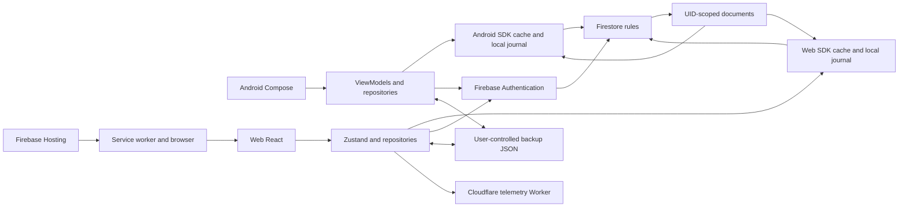

# 01 Architecture and scope

Audit baseline: `f3897a6befb6fef999c32447a78b7f68c83010d5` on `chore/release-2.1.17`. Initial `git status --short` was empty. The baseline has 542 tracked paths. Windows PowerShell, Node 24.16.0, npm 11.13.0 and Microsoft OpenJDK 21.0.11 were available. Private local config, ignored historical worktrees, build outputs, and live infrastructure settings are outside the tracked-source scope.

The inventory includes 214 Android paths, 250 web paths, six telemetry Worker paths, and shared Firebase, Gradle, workflow, script, fixture and documentation paths. Android uses AGP 9.4.1, Kotlin 2.4.20, Compose BOM 2025.06.00, Hilt 2.60.1, WorkManager 2.10.1, DataStore 1.1.7 and Firebase BOM 34.19.0. Its compile, target and minimum Android API levels are 37, 36 and 29. The web package uses React 19, TypeScript 6, Vite 8, Zustand 5 and Firebase SDK 13. Exact package pins are in `gradle/libs.versions.toml`, `app/build.gradle.kts` and `web/package-lock.json`.

| Component | Dependency and responsibility | Source |
|---|---|---|
| Android | Compose and ViewModels → injected repositories → Firebase Auth and Firestore, plus WorkManager reminders, encrypted preference storage and local pending-create state | `app/src/main/java/com/aus/ausgegeben/{ui,data,di,notification}`, `app/build.gradle.kts` |
| Web | Vite and React → view models and Zustand → Firebase SDK. Includes IndexedDB-backed Firestore where available, local UI and pending state, and a Workbox service worker. | `web/src/{views,viewmodels,repositories,services}`, `web/vite.config.ts` |
| Shared cloud schema | UID-scoped expense, category, budget, preference, recurring, receipt, restore-journal and snapshot documents | `firestore.rules:531–690`, `firestore.indexes.json`, both `FirestorePaths` implementations |
| Analytics | Client projections over expense snapshots, category data and local period/currency preferences | `web/src/utils/analytics.ts`, `app/src/main/java/com/aus/ausgegeben/util/InsightsAnalytics.kt` |
| Recurrence | Client-side due schedule → per-occurrence receipt and expense. Rules constrain category references and receipt shape. | Both `RecurringRepository` implementations, `fixtures/recurrence.json` |
| Backup and replace | Versioned JSON parse → snapshot → journal/lease → bounded Firestore commits → finish or recovery | `web/src/services/backup{Format,Replace,Restore,Snapshot}.ts`, `BackupRestoreRepository.kt`, `app/.../util/BackupFormat.kt` |
| Telemetry | Web diagnostics → opt-in reporter and token → Cloudflare Worker with independent validation and rate limits | `web/src/services/errorReporter.ts`, `tools/error-endpoint/src/index.js` |
| Delivery | Firebase Hosting serves static assets. GitHub Actions tests, assembles, verifies, attests and publishes APK releases | `firebase.json`, `.github/workflows/{ci,release,smoke}.yml` |
| Verification | Local unit tests, shared financial/recurrence/receipt/snapshot fixtures, rules and repository emulator tests, Android device and Robolectric integration, Playwright | `app/src/{test,androidTest}`, `web/{src,rules,emulator,e2e}`, `testdata`, `test-fixtures`, `scripts` |

Firebase Auth identity and token claims cross into Firestore rules at every authorized document operation. Rules enforce UID ownership and document-specific shape, mutation and relationship constraints. Clients choose report periods, derive amounts and aggregates, select what to display from cache, initiate recurrence, and orchestrate multi-batch restores. Local SDK acceptance, cache visibility, successful server commit, and restore completion are separate events. App Check attests an app context. Financial authorization is determined by identity and rules.

Backup import crosses an untrusted file boundary. A matching digest can detect accidental corruption where supported, while the parser and backend rules enforce shape. Exported data moves to a user-selected destination with that destination's retention and access controls. The browser service worker controls asset caching and updates. App telemetry crosses a separate origin and trust boundary. Signing material and release write permissions belong to the release workflow's protected environment as declared in YAML. Its live approval and tag protections require separate verification.

The schema models income, expenses and transfer-classified rows attached to categories. Budgets track expense rows. Transfer rows have no source or destination accounts, and the model has no account-level balances or paired transfer postings. Auth accounts govern data ownership.
